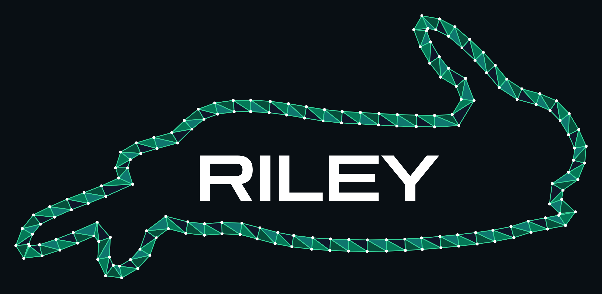
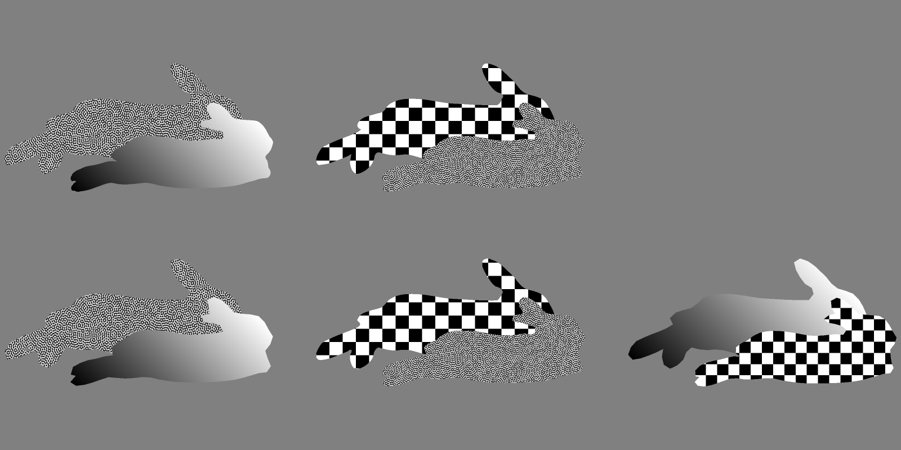
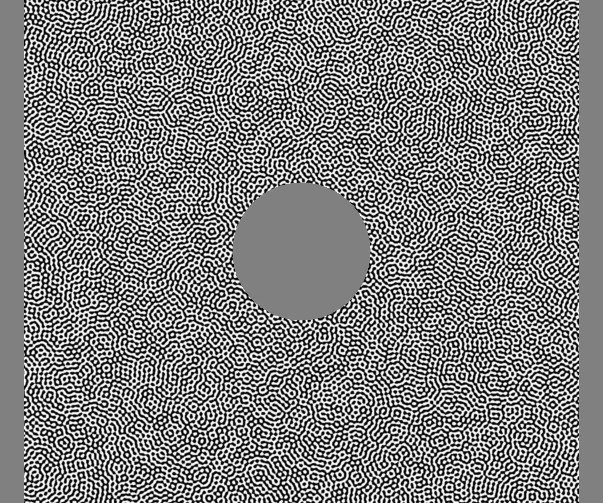
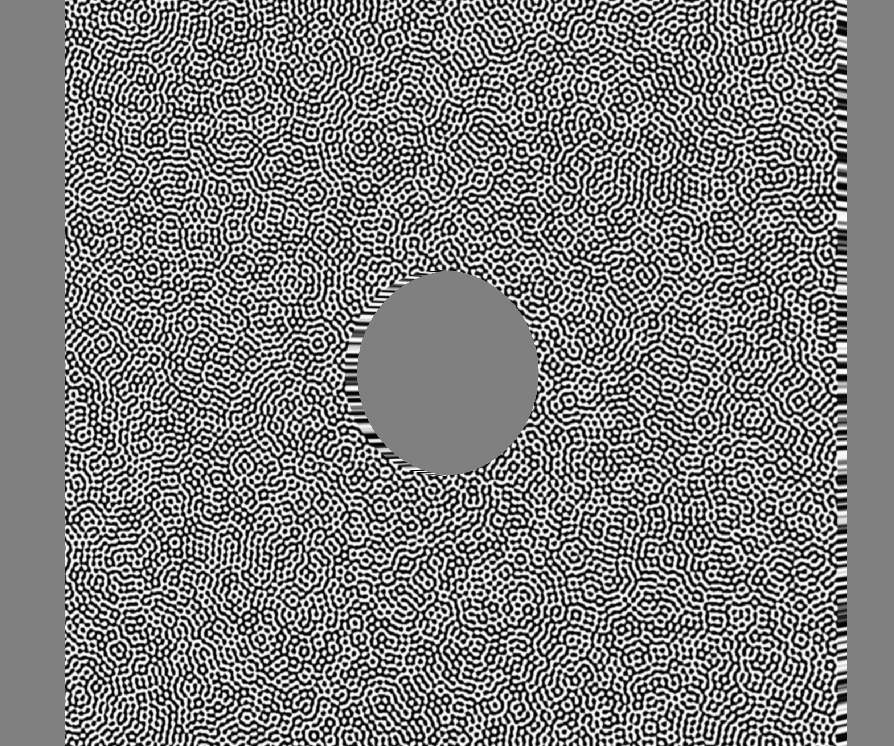
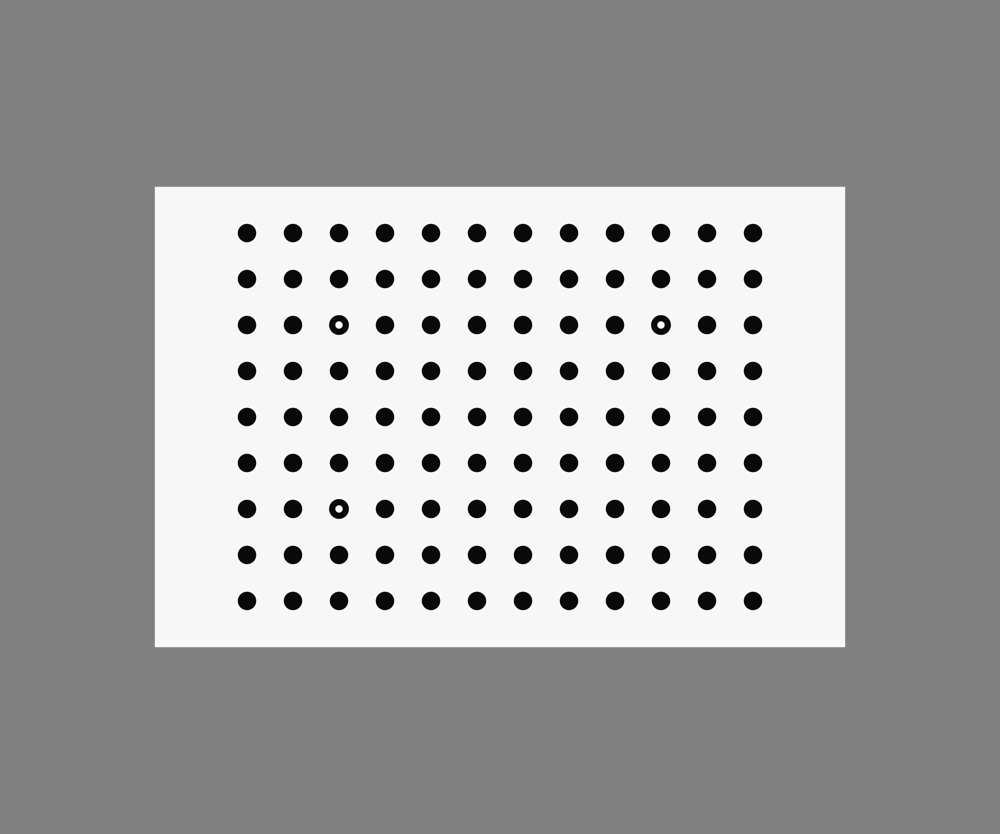
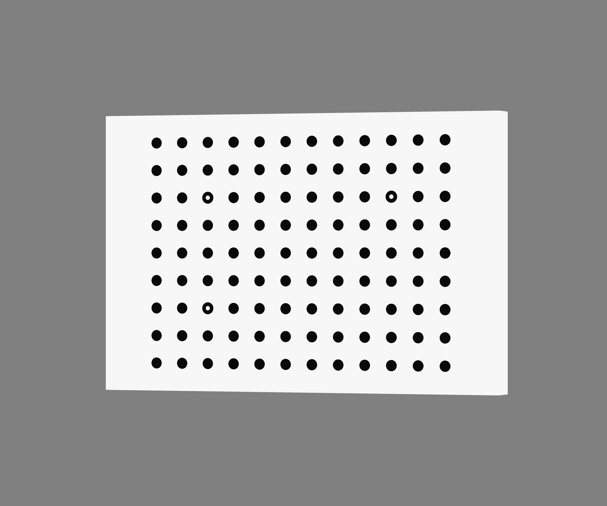
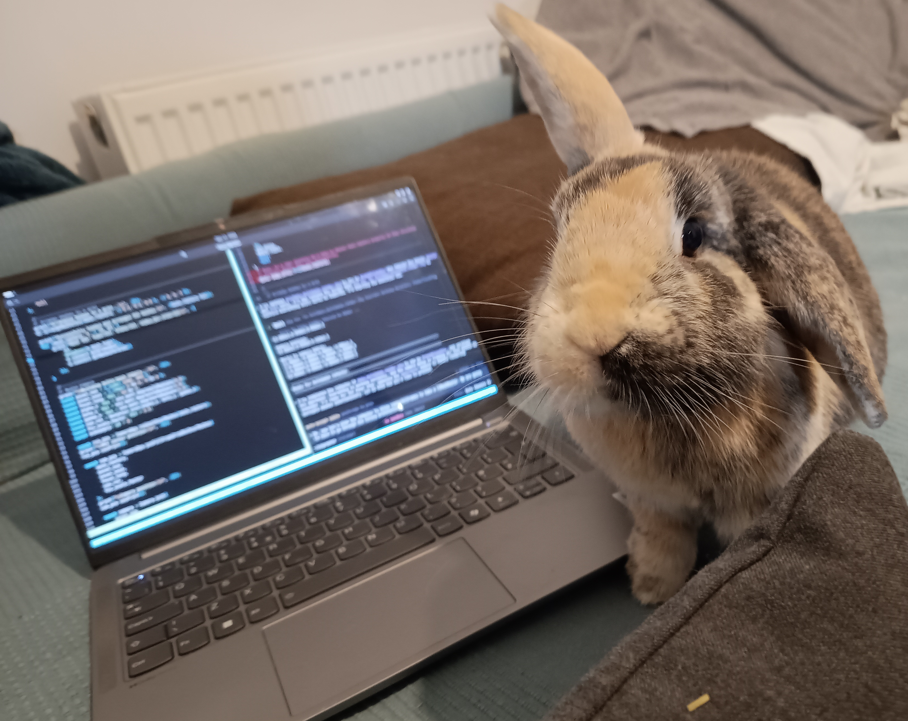

<p align="center">
  
</p>

<p align="center"><strong>A high performance rasteriser for digital image correlation uncertainty quantification.</strong></p>

<p align="center">
  <a href="https://ziglang.org/download/"></a>
  <a href="https://github.com/Computer-Aided-Validation-Laboratory/riley-raster/actions/workflows/zig-tests.yaml"></a>
  <a href="https://pypi.org/project/riley-raster/"></a>
  <a href="https://pypi.org/project/riley-raster/"></a>
  <a href="https://github.com/Computer-Aided-Validation-Laboratory/riley-raster/actions/workflows/python-package.yaml"></a>
  <a href="https://github.com/Computer-Aided-Validation-Laboratory/riley-raster/blob/main/LICENSE"></a>
</p>

Riley is an open-source high performance software rasteriser written in Zig for digital image correlation uncertainty quantification (DIC UQ). It synthesises deformed speckle images from finite element simulations, with higher order surface elements (`tri3`, `tri6`, `quad4`, `quad8`, and `quad9`), realistic camera models and distortion as well as texture/nodal/analytic shaders, and mixed scenes.

Riley's Zig core uses `comptime` specialisation and SIMD with `@Vector` to keep its rendering path fast and direct. It also uses hierarchical offline parallelisation allowing scaling over cameras and timesteps to be rendered. Riley is available as a Zig library and executable, a C compatible ABI, and the [`riley-raster`](https://pypi.org/project/riley-raster/) Python package which provides python bindings to the compiled Zig library.

## Quick start: Zig

Riley uses [Zig 0.16.0](https://ziglang.org/download/). Clone the repository,
then run the smallest demo from the repository root:

```shell
zig run ./src/demo00_quickstart.zig
```

No module flags or libc linkage are required. Direct runs use f64 with SIMD on;
add `-O ReleaseFast` for faster rendering. Build targets also work and allow
configuration through build options:

```shell
zig build demo00-quickstart -Doptimize=ReleaseFast
```

Renders are written to `out/`. Run the combined test suite with:

```shell
zig build test-verif-basic
```

## Quick start: Python

Install the published package:

```shell
python -m pip install riley-raster
python -m riley demo00_quickstart
```
Python renders are written below `out_riley_py/`.

## User Demos

Run the Zig commands from the repository root. Each example lists the Zig command
followed by its Python equivalent. Zig renders go to `out/`; Python renders go to
`out_riley_py/`.

Browse the complete [Zig demos](./src/) or [Python demos](./src/riley/pydemos/).

### Rabbits demo

The rabbit scene combines all supported element types and the principal shader families in a single render.

```shell
zig run ./src/demo02a_rabbits_mono.zig -O ReleaseFast
python -m riley demo02a_rabbits_mono
```



### Digital image correlation UQ demo

A representative stereo DIC UQ render of a plate with a hole in tension.

```shell
zig run ./src/demo03_dicuq.zig -O ReleaseFast
python -m riley demo03_dicuq
```

| Camera 0 | Camera 1 |
| :---: | :---: |
|  |  |

### Stereo calibration target demo

Stereo calibration target renders using the DIC UQ camera setup.

```shell
zig run ./src/demo04_stereocal.zig -O ReleaseFast
python -m riley demo04_stereocal
```

| Camera 0 | Camera 1 |
| :---: | :---: |
|  |  |

## Verification and regression tests

The Zig suites are separated by purpose and reference-data size. Verification and basic references are included in the repository. Builds default to f64 with SIMD on, and the focused verification driver requires that configuration. Run verif/basic in Debug and full in ReleaseSafe; see `zig build --help` for targets and configuration options.

| Command | Purpose |
| --- | --- |
| `zig build test-verif-basic` | Fast combination of focused analytic verification and basic regression tests. |
| `zig build test-verif` | Analytic verification of the solver, silhouettes, depth buffer, and camera distortion. |
| `zig build test-basic` | Basic regression suite. |
| `zig build test-full -Doptimize=ReleaseSafe` | Full regression suite. |

Note that the data for the `full` test suite is large and will need to be generated using the appropriate data generation script after verifying that the `verif` and `basic` test suites pass. See the [developer docs](https://github.com/Computer-Aided-Validation-Laboratory/riley-raster/tree/main/dev) for more details on the tests.

The packaged Python test suite can be run with:

```shell
python -m pytest --pyargs riley.pytests -s
```

or:

```shell
python -m riley test
```

The Python suite includes comparisons against Zig demo output. These parity checks require the repository assets and Zig compiler and skip when those prerequisites are unavailable; other packaged tests still run.

## Zig API

The main user-facing Zig API is [src/riley/zig/api.zig](./src/riley/zig/api.zig).
It exposes render entry points and input/configuration types directly, with
`dataio`, `maths`, and `ops` namespaces assembled in [api/](./src/riley/zig/api/).
Repository demos import this facade by relative path:

```zig
const riley = @import("riley/zig/api.zig");
const datio = riley.dataio;
const maths = riley.maths;
const ops = riley.ops;
```

External applications can register `api.zig` as a module named `riley` in their
own build and use `@import("riley")`.

Use `riley.raster(...)` or `riley.rasterInto(...)` to render camera and mesh inputs.
Types such as `CameraInput`, `MeshInput`, `RasterConfig`, `MeshShaderSetInput`, and
`ResolverInput` are exposed directly. `riley.dataio` provides mesh, UV, image,
and camera I/O; `riley.maths` provides numerical types; `riley.ops` provides
scene arrangement, camera framing, and shader-input construction helpers.

The render entry functions are **defined in
[src/riley/zig/riley.zig](./src/riley/zig/riley.zig)**. Start there to follow the
processing flow: input validation, camera preparation and mesh Static creation,
frame/camera preparation, rasterisation and shading, then image output.
`api.zig` is the public facade; `riley.zig` owns render orchestration.

## C API
`Riley` provides a C-compatible API for use from other languages. The Python bindings use this interface through Cython, but it can also be called from C or from any language with a C FFI.

The public C ABI is intentionally fixed to the production Riley build with: precision=`f64`, SIMD=`on`. The exported implementation and extern descriptors live in [c-riley.zig](./src/riley/zig/c-riley.zig); C declarations are provided in [riley.h](./src/riley/cython/riley.h).


## Project Layout
Useful locations:

- `src/`: Zig demos, tests, benchmarks and the core Riley source
- `src/riley/zig/`: core Zig raster pipeline implementation
- `src/riley/zig/api.zig`: main user-facing Zig API facade
- `src/riley/zig/api/`: declarations assembled for the facade and its namespaces
- `src/riley/zig/riley.zig`: render entry function definitions and orchestration
- `src/riley/cython/`: Cython->Python bindings for Riley
- `src/riley/python/`: Python utilities for setup and mesh manipulation
- `src/riley/pydemos/`: packaged Python demos
- `src/riley/pytests/`: packaged Python tests
- `gold/`: gold reference renders for regression testing
- `out/`: Zig render and benchmark output
- `out_riley_py/`: Python render output
- `dev/README.md`: detailed developer testing and benchmark notes

For a mathematical and architectural overview, see the engrXiv preprint: [Riley: A computational framework for higher-order finite element image synthesis applied to digital image correlation uncertainty quantification](https://engrxiv.org/preprint/view/7300/version/9460).


## Citing Riley
If you have found `Riley` useful you can cite it using:

> Fletcher, L., Hirst, J., and Bielajewa, W. (2026).
> *Riley: A computational framework for higher-order finite element image synthesis applied to digital image correlation uncertainty quantification*.
> engrXiv preprint. https://engrxiv.org/preprint/view/7300

```bibtex
@article{fletcher2026riley,
  title   = {Riley: A computational framework for higher-order finite element image synthesis applied to digital image correlation uncertainty quantification},
  author  = {Fletcher, Lloyd and Hirst, Joel and Bielajewa, Wiera},
  year    = {2026},
  journal = {engrXiv},
  note    = {Preprint},
  url     = {https://engrxiv.org/preprint/view/7300}
}
```

## Contributors
- Lloyd Fletcher ([ScepticalRabbit](https://github.com/ScepticalRabbit)), UK Atomic Energy Authority
- Joel Hirst ([JoelPhys](https://github.com/JoelPhys)), UK Atomic Energy Authority
- Wiera Bielajewa ([WieraB](https://github.com/WieraB)), UK Atomic Energy Authority
- James Panayis ([james-panayis](https://github.com/james-panayis)), UK Atomic Energy Authority
- Megan Sampson ([meganasampson](https://github.com/meganasampson)), UK Atomic Energy Authority

## Dedication
Named in memory of Riley, and for Feebee, her sister and bondmate. Without your love and support, this project would never have happened.


