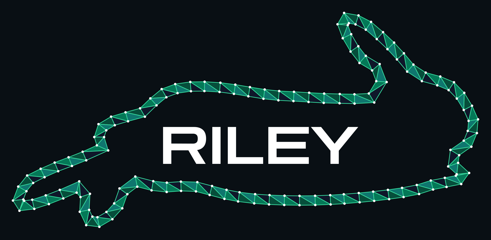

riley-raster documentation
==========================

.. |pypi| image:: https://img.shields.io/pypi/v/riley-raster
   :target: https://pypi.org/project/riley-raster/
   :alt: PyPI version

.. |github| image:: https://img.shields.io/badge/github-repo-blue?logo=github
   :target: https://github.com/Computer-Aided-Validation-Laboratory/riley-raster
   :alt: GitHub repository

.. |issues| image:: https://img.shields.io/github/issues/Computer-Aided-Validation-Laboratory/riley-raster
   :target: https://github.com/Computer-Aided-Validation-Laboratory/riley-raster/issues
   :alt: Open GitHub issues

.. |PR| image:: https://img.shields.io/github/issues-pr/Computer-Aided-Validation-Laboratory/riley-raster
   :target: https://github.com/Computer-Aided-Validation-Laboratory/riley-raster/pulls
   :alt: Open GitHub Pull Requests

.. |license| image:: https://img.shields.io/github/license/Computer-Aided-Validation-Laboratory/riley-raster
   :target: https://choosealicense.com/licenses/mit/
   :alt: MIT License

|pypi| |github| |issues| |PR| |license|

Riley is a high performance Zig software rasteriser for digital image correlation
uncertainty quantification (DIC UQ). It synthesises deformed speckle images from
finite element simulations, with higher order surface elements
(tri3, tri6, quad4, quad8, and quad9), camera models and distortion,
texture/nodal/analytic shaders, and mixed scenes.

Riley's Zig core uses ``comptime`` specialisation and SIMD with ``@Vector`` to
keep its rendering path fast. It parallelises rendering across cameras and
timesteps. Riley is available as a Zig library and executable, through a
C-compatible ABI, and as the ``riley-raster`` Python package, which provides
bindings to the compiled Zig library.

`Zig API documentation <zig-api/index.html>`_

.. toctree::
   :maxdepth: 2
   :caption: Contents:

   install/install
   riley-examples/examples
   python-api
   tests/tests
